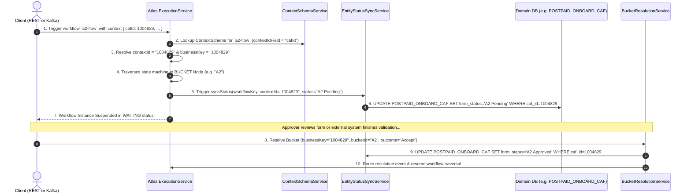
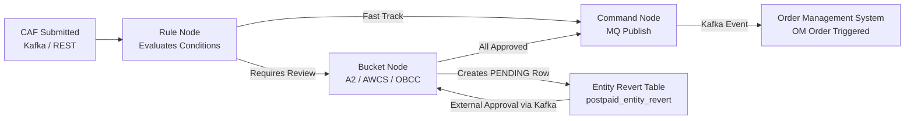

# Atlas Workflow Engine: Context Schema, Identifiers & Execution Guide

This document explains the core identity concepts (`contextId`, `businessKey`, `contextIdField`, and `targetPkColumn`), how they synchronize database domain entities in **Bucket Workflows**, and how to trigger workflows via **REST API** and **Apache Kafka**.

---

## 1. Core Identity Concepts & Mental Model

When developing workflows in Atlas, identifiers exist across three distinct layers:

| Concept | Layer | Definition | Concrete Example |
| :--- | :--- | :--- | :--- |
| **`contextIdField`** | Context Schema Definition | The schema configuration property telling the engine: *"Which key in the input context JSON map holds the primary business entity ID?"* | `"cafId"` or `"orderId"` |
| **`contextId`** | Workflow Runtime Context | The actual runtime value extracted from `contextIdField`. Used internally across task execution logs and domain sync services. | `"1004829"` |
| **`businessKey`** | State Machine Instance | The human-readable correlation key stored on the `WorkflowInstance` entity. External brokers (Kafka, MQ) and APIs use this key to correlate events and resume suspended instances. | `"1004829"` or `"CAF-1004829"` |
| **`targetTable` & `targetPkColumn`** | Relational Database Layer | The physical database table and primary key column that gets updated whenever the workflow enters or resolves a Bucket stage. | Table: `POSTPAID_ONBOARD_CAF`<br>PK Column: `caf_id` |

---

## 2. End-to-End Architecture & Lifecycle

The following diagram illustrates how the JSON payload maps to Context Schema, updates the database at Bucket stages, and resumes upon resolution:



---

## 3. ID Resolution & Fallback Ladder

When triggering an execution, **passing explicit `contextId` or `businessKey` parameters is optional**. The engine resolves them using this fallback order in `ExecutionService`:

### A. `contextId` Resolution
1. **Explicit Request Parameter**: `request.getContextId()`.
2. **Context Schema Property**: Looks up `context.get(schema.getContextIdField())` (e.g., `cafId`).
3. **Common Key Names**: Checks for keys `"contextId"`, `"cafId"`, or `"trackingId"` inside the context map.
4. **Business Key Fallback**: If `businessKey` was passed, `contextId` adopts that value.
5. **Auto-Generated Fallback**: Generates `UUID.randomUUID().toString()`.

### B. `businessKey` Resolution
1. **Explicit Request Parameter**: `request.getBusinessKey()`.
2. **Common Context Keys**: Checks for keys `"businessKey"`, `"cafId"`, `"transactionId"`, `"orderId"`, or `"trackingId"`.
3. **Context ID Fallback**: Falls back to the resolved `contextId`.
4. **Final Fallback**: `"BK-" + instanceId.substring(0, 8)`.

> [!TIP]
> If your Context Schema defines `contextIdField = "cafId"`, you only need to include `"cafId": 1004829` inside your `context` payload. The engine automatically populates both `contextId` and `businessKey` with `"1004829"`.

---

## 4. Triggering Workflows via REST API

### Endpoint Specification
* **Method:** `POST`
* **URL:** `http://<host>:9091/api/execute/{workflowKey}`
* **Header:** `Content-Type: application/json`

### Example: Triggering `a2-flow`
```bash
curl -X POST http://localhost:9091/api/execute/a2-flow \
  -H "Content-Type: application/json" \
  -d '{
    "context": {
      "cafId": 1004829,
      "circleId": 101,
      "customerName": "Alice Smith",
      "planName": "Postpaid Max",
      "simType": "ESIM",
      "channel": "RETAIL"
    }
  }'
```

### Sample Response (`201 Created` / `ExecutionLogDto`)
```json
{
  "id": "e931ca8f-fbb2-4a0b-9df0-b08e2f08a541",
  "workflowKey": "a2-flow",
  "versionNumber": 1,
  "instanceId": "c4d129fa-118c-4a30-8c87-897103dfb3a4",
  "businessKey": "1004829",
  "contextId": "1004829",
  "status": "WAITING",
  "outcomeNodeLabel": "A2 Verification",
  "steps": [
    {
      "stepOrder": 1,
      "nodeId": "start-node",
      "nodeLabel": "Start",
      "status": "COMPLETED"
    },
    {
      "stepOrder": 2,
      "nodeId": "bucket-a2",
      "nodeLabel": "A2 Verification",
      "status": "WAITING",
      "notes": "Suspended execution. Waiting on business outcome bucket: A2 Verification"
    }
  ]
}
```

---

## 5. Triggering Any Workflow via Apache Kafka

The Atlas engine includes a native Kafka consumer (`KafkaEventListener`) capable of dynamically triggering **any workflow** registered in the engine (e.g. `a2-flow`, `sim-swap`, `port-in`, `device-repair`, or any custom workflow).

### Kafka Topic Details
* **Default Topic Name:** `caf-lifecycle` (configurable via `kafka.topics.lifecycle` in `application.yml`)
* **Consumer Group ID:** `atlas-workflow-group`
* **Message Key:** `"1004829"` or your entity's unique key *(recommended: partition on `contextId` / `businessKey`)*

### 1. Generic Workflow Trigger Payload (Recommended for Any Workflow)
You can trigger **any** workflow by specifying `workflowKey` and using `contextId` or `businessKey`. Any arbitrary key-value pairs needed by the workflow nodes/conditions can be supplied inside `context`:

```json
{
  "workflowKey": "sim-swap-flow",
  "contextId": "SWAP-89231",
  "businessKey": "MSISDN-9876543210",
  "context": {
    "requestId": "SWAP-89231",
    "msisdn": "9876543210",
    "simType": "ESIM",
    "channel": "STORE",
    "agentId": "AGT-552"
  }
}
```

### 2. CAF-Specific Workflow Trigger Payload (`CafSubmittedEvent` Alias)
For telecom customer application form (CAF) workflows (such as `a2-flow`), you can use the domain-specific `cafId` field. The engine automatically maps `cafId` ↔ `contextId`:

```json
{
  "workflowKey": "a2-flow",
  "cafId": "1004829",
  "context": {
    "cafId": 1004829,
    "circleId": 101,
    "customerName": "Alice Smith",
    "planName": "Postpaid Max",
    "simType": "ESIM",
    "channel": "RETAIL"
  }
}
```

### How the Engine Executes Any Workflow from Kafka
When `KafkaEventListener` consumes a message:
1. **Dynamic Routing:** Reads `event.getWorkflowKey()`. If not provided, it defaults to `"order_processing"`.
2. **Context ID Resolution:** Resolves `contextId` from `event.getContextId() != null ? event.getContextId() : event.getCafId()`.
3. **Execution Service Call:** Dispatches directly to `executionService.execute(workflowKey, executionRequestDto)`.
4. **Context Schema & Primary Key Validation:** Validates the payload against the workflow definition's primary key and Context Schema rules.

### Kafka Producer CLI Example
```bash
# Example: Triggering a generic workflow
kafka-console-producer.sh --bootstrap-server localhost:9092 --topic caf-lifecycle \
  --property "parse.key=true" --property "key.separator=:"

SWAP-89231:{"workflowKey":"sim-swap-flow","contextId":"SWAP-89231","context":{"msisdn":"9876543210","channel":"STORE"}}

# Example: Triggering a CAF workflow
1004829:{"workflowKey":"a2-flow","cafId":"1004829","context":{"cafId":1004829,"circleId":101,"customerName":"Alice Smith"}}
```

---

## 6. Bucket Stage Suspensions & Domain Synchronization

When the workflow hits a BUCKET node (such as `A2`), `BucketSuspensionManager` executes:

1. **Creates a `BucketExecution` entity** in state `PENDING` with SLA and priority.
2. **Creates a `RevertStatus` / `EntityRevert` record** chaining to previous completed steps for audit and step-back capabilities.
3. **Synchronizes the Domain Database Table**:
   * Evaluates `DomainConventionService` against the schema.
   * If `a2-flow` overrides `targetTable` and `targetPkColumn`, it uses those.
   * Otherwise, it matches prefixes (e.g. `CAF_` $\rightarrow$ `POSTPAID_ONBOARD_CAF`, PK `caf_id`) or falls back to `POSTPAID_ONBOARD_CAF`.
   * Executes:
     ```sql
     UPDATE POSTPAID_ONBOARD_CAF 
     SET form_status = 'A2 Pending' 
     WHERE caf_id = 1004829;
     ```

---

## 7. Resolving Bucket Stages to Resume Workflow

Once manual verification, document check, or external evaluation is complete, the workflow is resumed by publishing a resolution signal.

### Option A: Via Kafka (`workflow-bucket-resolution` topic)
```json
{
  "cafId": 1004829,
  "bucketId": "A2",
  "outcome": "Accept",
  "resolvedBy": "Agent_Bob",
  "resolutionNotes": "All documents verified and approved"
}
```
*(Note: External systems do not need internal `instanceId`. You can provide numeric `cafId` or string `businessKey`. If domain status like `"status": "A2Accept"` is supplied instead of `outcome`, the engine automatically strips the bucket prefix).*

### Option B: Via REST API
```bash
POST http://localhost:9091/api/bucket-executions/{bucketExecutionId}/resolve
Content-Type: application/json

{
  "outcome": "Accept",
  "resolvedBy": "Agent_Bob",
  "notes": "All documents verified and approved"
}
```

### What Happens on Resolution:
1. `BucketExecution` record status changes from `PENDING` $\rightarrow$ `RESOLVED`.
2. Domain table status is updated:
   ```sql
   UPDATE POSTPAID_ONBOARD_CAF 
   SET form_status = 'A2 Approved' 
   WHERE caf_id = 1004829;
   ```
3. `EventRoutingService` correlates `businessKey = "1004829"`, unpauses the instance, and resumes traversal along the outbound edge matching outcome `"Accept"` to the next bucket or completion node.

---

## 8. End-to-End Operational Journey: Rule Decisioning, Bucket Revert Tracking & OM Order Trigger

This section describes how an order moves through the workflow in production—how business rules evaluate context, how verification buckets pause execution and record revert entries, how approvals resume the journey via Kafka without internal UUIDs, and how the final Order Management (OM) order creation is triggered.



### 8.1 Workflow Ingestion (`caf-lifecycle`)
When CAF processing triggers the workflow, the payload is published to Kafka topic `caf-lifecycle` (with fallback to REST if Kafka send fails). The engine automatically normalizes all fields into the workflow execution context:

| Field | Context Key | Example Value | Description |
| :--- | :--- | :--- | :--- |
| **`cafId`** (root) | `cafId` | `"880011"` | Customer CAF identifier |
| **`workflowKey`** | `workflowKey` | `"postpaid-ind-workflow"` | Target workflow definition |
| **`circleId`** | `circleId` | `22` | Numeric telecom circle |
| **`kycMode`** | `kycMode` | `"DKYC"` | Verification type (`EKYC`, `DKYC`, `SKYC`) |
| **`statusOfSubscriber`** | `statusOfSubscriber` | `"ACTIVE"` | Subscriber lifecycle state |
| **`isPwd`, `isAwcs`, `isTest`** | `isPwd`, `isAwcs` | `true`, `false` | Physical disability / out-of-circle flags |
| **`simexDaysDif`, `configDays`** | `simexDaysDif` | `15`, `30` | Migration thresholds (Pre-to-Post) |
| **`actType`, `custType`** | `actType` | `"NEW"`, `"INDIVIDUAL"` | Activation association metadata |

### 8.2 How Rules Route the Order (Decisioning)
Before moving into manual verification queues, **Rule Nodes** evaluate dynamic SpEL conditions against the normalized context attributes:

* **DKYC Verification Rule**:
  * *Condition*: `context.kycMode == 'DKYC'`
  * *Action*: Routes the order to the **A2 Bucket** for manual document and photo matching.
* **Out-of-Circle Approval Rule (AWCS)**:
  * *Condition*: `context.isAwcs == 'Y' || context.circleId != context.homeCircleId`
  * *Action*: Routes the order to the **AWCS Bucket** for inter-circle clearance.
* **Pre-to-Post Migration Threshold Rule**:
  * *Condition*: `context.simexDaysDif > context.configDays`
  * *Action*: Routes the order to the **Supervisor Review Bucket**.
* **Zero-Touch Fast Track**:
  * If the submission is verified `EKYC` and all risk flags are negative (`isAwcs == false && isPwd == false`), the rule branches evaluate directly to the final provisioning command node without manual pauses.

### 8.3 Bucket Movement & Domain Revert Tracking (`postpaid_entity_revert`)
When an order routes into a **Bucket Node** (e.g. `A2`, `AWCS`), traversal pauses to await human or external system review:

1. **Active Revert Record Insertion**:
   * The engine inserts a new active row into **`postpaid_entity_revert`**:
     * `caf_id`: The customer CAF ID (e.g. `880011`).
     * `circle_id`: The circle ID extracted from context (e.g. `22`).
     * `bucket_id`: The bucket being paused on (e.g. `'A2'`).
     * `revert_status`: Set to `PENDING` (or node-defined status such as `A2_PENDING_MANUAL`).
     * `revert_seq_number`: Incrementing sequence number for this CAF.
     * `is_active`: `'Y'`.
2. **CAF Master Table Synchronization**:
   * Updates `POSTPAID_ONBOARD_CAF.form_status` to `'A2 Pending'` (or configured pending status).
3. **Queue Visibility**:
   * External agent portals, queue managers, and circle supervisors query `postpaid_entity_revert` by `circle_id` and `bucket_id` to distribute review workload.

### 8.4 Bucket Resolution & Workflow Resumption (Kafka)
Once review is completed in the external approval portal, the verification system emits a resolution event to Kafka topic **`workflow-bucket-resolution`**:

* **Kafka Resolution Payload**:
  *(Note: External approval systems only supply `cafId` and `bucketId`—they do not need to know or transmit internal engine `instanceId`)*
  ```json
  {
    "cafId": 880011,
    "bucketId": "A2",
    "outcome": "Accept",
    "resolvedBy": "SeniorOfficer_42",
    "resolutionNotes": "Biometric and Proof of Address verified"
  }
  ```
  *(Domain status like `"status": "A2Accept"` is also accepted; the engine automatically normalizes it to outcome `"Accept"`).*

* **Engine Synchronization on Resolution**:
  1. Finds the active revert entry in `postpaid_entity_revert` for that `cafId` and `bucketId`.
  2. Updates `postpaid_entity_revert.revert_status = 'COMPLETED'` and records `revert_person_id`.
  3. Updates `POSTPAID_ONBOARD_CAF.form_status = 'A2Accept'`.
  4. Resumes workflow execution along the outbound edge matching outcome `"Accept"` to the next node.

### 8.5 Triggering the OM Order via Kafka Command Node
Once all required bucket approvals and verification stages are satisfied, the workflow transitions into a **Command Node (MQ Publish)**:

1. **Outgoing Payload Mapping**:
   * The node compiles an Order Creation payload mapped directly from the workflow context:
     ```json
     {
       "cafId": "880011",
       "circleId": 22,
       "status": "APPROVED",
       "kycMode": "DKYC",
       "resolvedBy": "SeniorOfficer_42",
       "action": "CREATE_OM_ORDER"
     }
     ```
2. **Kafka Event Emission**:
   * The engine publishes this message to the downstream Order Management Kafka topic (e.g. `vth.downstream.notifications` or `om-order-requests`).
   * The partition key is set to `${context.cafId}` to ensure partitioned in-order processing.
3. **Downstream OMS Provisioning**:
   * The Order Management System (OMS) consumes the Kafka message, reserves the MSISDN / IMSI, provisions billing and network profiles, and generates the final Order ID.
   * The workflow completes with status **`COMPLETED`**.

---

### 8.6 Summary Lifecycle & State Transition Matrix

| Stage | Trigger / Origin | Action on `postpaid_entity_revert` | Action on `POSTPAID_ONBOARD_CAF` | Kafka Topic Involved |
| :--- | :--- | :--- | :--- | :--- |
| **1. Ingestion** | CAF Submission | None | `form_status = 'SUBMITTED'` | `caf-lifecycle` |
| **2. Rule Check** | In-Memory SpEL | None | Evaluates flags (`kycMode`, `isAwcs`, etc.) | None |
| **3. Bucket Pause** | Review Node Hit | Insert row (`PENDING`, `bucket_id = 'A2'`, `circle_id`) | `form_status = 'A2 Pending'` | None (Task enqueued) |
| **4. Bucket Approval**| Agent Portal Resolution | Update row to `COMPLETED`, record `revert_person_id` | `form_status = 'A2Accept'` | `workflow-bucket-resolution` |
| **5. OM Order Trigger**| Final Command Node | Audit trail preserved | `form_status = 'COMPLETED'` | `vth.downstream.notifications` (OMS) |
